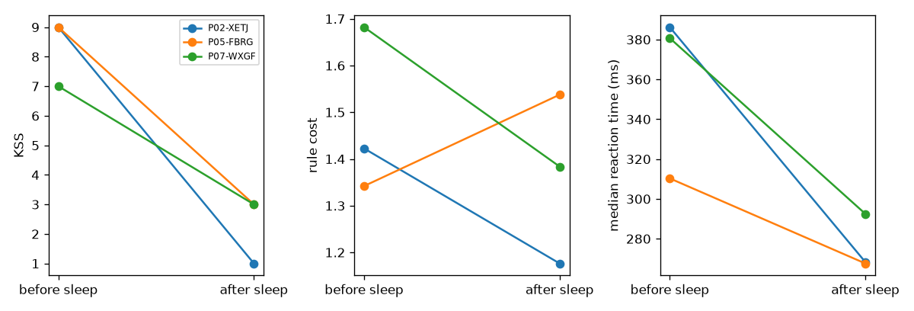

# Tiredness from typing: results

Data from `../data/sim/effect`, analysed Sat 07 Nov 19:27. 122 check-ins: 95 from 7 panel people and 27 from 20 one-off people. 81 panel check-ins are scored; each person's first 2 are their baseline.

- 3 vowel task timings dropped because the page lost focus.
- 4 free text timings dropped because the page lost focus.
- 4 check-ins were stopped early; their finished tasks are used.

## Findings

- Typing alone predicted tiredness with an average error of 1.26 KSS points, better than hours awake alone (1.40). Always guessing the average gives 1.93.
- Clock check: typing carries information beyond hours awake. Adding it to hours awake cut the error from 1.40 to 1.17 KSS points (shuffle test p = 0.002).
- The original test, which shuffles ratings within each person, gives p = 0.002.
- After allowing for practice, the rule cost changed by 0.005 per hour awake (95% CI -0.004 to 0.014), which isn't clearly different from zero.
- Gaps next to a capital took 1.53× as long as ordinary gaps (Wilcoxon p < 0.001, 119 check-ins), so the vowel rule does cost time.
- Across 3 sleeps, KSS changed by -6.0 on average and the rule cost by -0.12.
- For 20 one-off people, who have no baseline, the model was better than always guessing the panel average (error 1.24 vs 1.53 KSS points).

## How well does typing predict tiredness?

Each person is predicted by a model trained on everyone else. Anchored models predict the change from the person's own baseline rating, then add it back. Predictions use typing only; hours awake is a benchmark, because the demo can't ask for it.

| Model | Error (MAE, KSS points) | Spearman | Spearman within person (median) |
|---|---|---|---|
| Training mean | 1.93 | – | – |
| Own baseline rating | 3.15 | – | – |
| Hours awake (benchmark) | 1.40 | 0.60 | 0.88 |
| Typing only (main) | 1.26 | 0.67 | 0.75 |
| Typing + reaction test | 0.95 | 0.80 | 0.83 |
| Typing without rule cost | 1.26 | 0.67 | 0.71 |
| Typing, not anchored | 1.31 | 0.73 | 0.82 |
| Typing + hours awake (check only) | 1.17 | 0.70 | 0.82 |

**Clock check.** Adding typing to hours awake changes the error from 1.40 to 1.17 KSS points. Shuffling the typing features within each person 500 times gives p = 0.002. A small p-value means typing knows something the clock doesn't.

**Original test.** Shuffling ratings within each person, as in the plan, gives a typing-only error of 1.34 and p = 0.002. This test can't tell typing apart from anything else that drifts over the night.

**Tired vs alert** (above each person's median KSS or not): AUC 0.70 with typing alone, 0.79 with hours awake alone.

## Mixed models

### Tiredness

`kss ~ hours_awake + log_checkin + vt_gap_cv_dev + vt_rule_cost_dev`, random intercept per person.

93 check-ins from 7 people.

| Term | Coefficient | 95% CI | p |
|---|---|---|---|
| Intercept | 1.384 | 0.540 to 2.228 | 0.001 |
| hours_awake | 0.222 | 0.160 to 0.284 | < 0.001 |
| log_checkin | 0.914 | 0.484 to 1.344 | < 0.001 |
| vt_gap_cv_dev | 1.017 | -0.572 to 2.607 | 0.210 |
| vt_rule_cost_dev | 0.979 | -0.351 to 2.310 | 0.149 |

### Rule cost

`vt_rule_cost ~ hours_awake + log_checkin`, random intercept per person.

93 check-ins from 7 people.

| Term | Coefficient | 95% CI | p |
|---|---|---|---|
| Intercept | 1.474 | 1.344 to 1.603 | < 0.001 |
| hours_awake | 0.005 | -0.004 to 0.014 | 0.275 |
| log_checkin | -0.018 | -0.086 to 0.051 | 0.607 |

## Is the vowel rule really harder?

Median gap next to a capital ÷ median ordinary gap: 1.53 across 119 check-ins (Wilcoxon signed-rank p < 0.001).

## Before and after sleep

| Person | Slept (min) | KSS | Rule cost | Median RT (ms) |
|---|---|---|---|---|
| P02-XETJ | 162 | 9 → 1 | 1.42 → 1.18 | 386 → 268 |
| P05-FBRG | 179 | 9 → 3 | 1.34 → 1.54 | 310 → 268 |
| P07-WXGF | 171 | 7 → 3 | 1.68 → 1.38 | 381 → 292 |

## One-off people

A model trained on all panel check-ins, using only features that need no baseline (vt_rule_cost, vt_gap_cv, vt_accuracy, backspace_per100), predicted 27 check-ins from 20 one-off people with an error of 1.24 KSS points. Always guessing the panel average gives 1.53.

## Notes

- Typing features in the models: vt_rule_cost_dev, backspace_per100, vt_accuracy_dev, vt_gap_cv_dev, vt_pause1s_share_dev, vt_hold_med_dev, ft_pause2s_share_dev.
- Fixed features with no data here: none.
- Reaction-test features: rt_lapse_rate_dev.
- `_dev` features are each person's change from the average of their first two check-ins. Backspaces per 100 keys are used as they are. Hours awake reset after a sleep of an hour or more.
- Lapses are reaction times of 355 ms or more, the cut-off for the 3-minute test.
