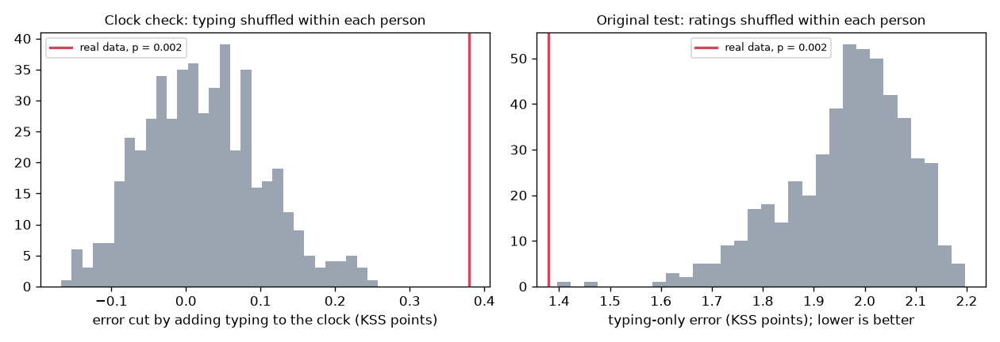
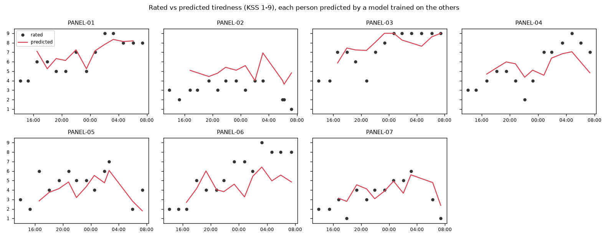
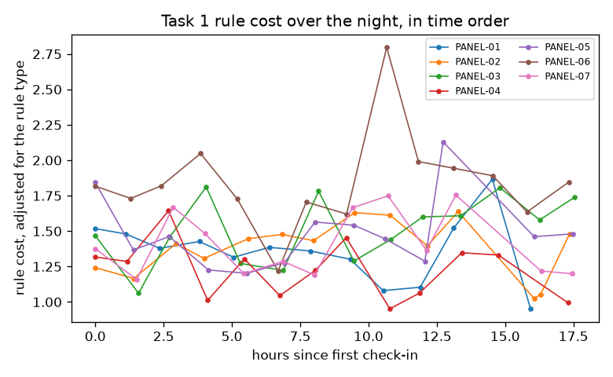
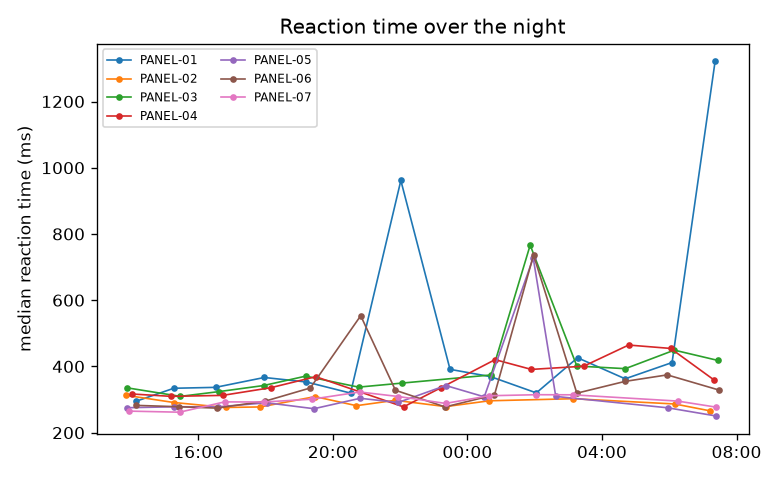

# Tiredness from typing: results

Data from `../data/sim/effect`, analysed Sat 07 Nov 20:09. 129 check-ins: 96 from 7 panel people and 33 from 20 one-off people. 80 panel check-ins are scored; each person's first 2 are their baseline. 12 in-progress checkpoint files were skipped.

- Task 1 rules shown: dashes_for_spaces 30, dots_and_vowels 29, capitalize_vowels 25, dashes_and_vowels 23, capitalize_first_and_last 22.
- The clock is hours since first check-in.
- 2 Task 1 timings dropped because the page lost focus.
- 6 check-ins were stopped early; their finished tasks are used.

## Findings

- Typing alone predicted tiredness with an average error of 1.29 KSS points, better than the clock alone (hours since first check-in: 1.64). Always guessing the average gives 2.07.
- Clock check: typing carries information beyond the clock. Adding it to the clock cut the error from 1.64 to 1.26 KSS points (shuffle test p = 0.002).
- The original test, which shuffles ratings within each person, gives p = 0.002.
- After allowing for practice and the rule type, the rule cost changed by 0.003 per hour on the clock (95% CI -0.024 to 0.030), which isn't clearly different from zero.
- Gaps next to a rule key (a capital, dash or dot) took 1.44× as long as ordinary gaps (Wilcoxon p < 0.001, 127 check-ins), so the rules do cost time.
- For 20 one-off people, who have no baseline, the model was better than always guessing the panel average (error 1.85 vs 1.89 KSS points).

## How well does typing predict tiredness?

Each person is predicted by a model trained on everyone else. Anchored models predict the change from the person's own baseline rating, then add it back. Predictions use typing only; the clock (hours since first check-in) is a benchmark, because the demo can't ask for it.

| Model | Error (MAE, KSS points) | Spearman | Spearman within person (median) |
|---|---|---|---|
| Training mean | 2.07 | – | – |
| Own baseline rating | 2.71 | – | – |
| Clock (benchmark) | 1.64 | 0.38 | 0.72 |
| Typing only (main) | 1.29 | 0.68 | 0.63 |
| Typing + reaction test | 1.27 | 0.70 | 0.61 |
| Typing without rule cost | 1.27 | 0.68 | 0.63 |
| Typing, not anchored | 1.39 | 0.64 | 0.65 |
| Typing + clock (check only) | 1.26 | 0.66 | 0.59 |

**Clock check.** Adding typing to the clock changes the error from 1.64 to 1.26 KSS points. Shuffling the typing features within each person 500 times gives p = 0.002. A small p-value means typing knows something the clock doesn't.

**Original test.** Shuffling ratings within each person, as in the plan, gives a typing-only error of 1.38 and p = 0.002. This test can't tell typing apart from anything else that drifts over the night.

**Tired vs alert** (above each person's median KSS or not): AUC 0.75 with typing alone, 0.76 with the clock alone.

## Mixed models

### Tiredness

`kss ~ hours_clock + log_checkin + vt_gap_cv_dev + vt_rule_cost_dev`, random intercept per person.

91 check-ins from 7 people.

| Term | Coefficient | 95% CI | p |
|---|---|---|---|
| Intercept | 2.379 | 0.912 to 3.845 | 0.001 |
| hours_clock | 0.002 | -0.160 to 0.164 | 0.983 |
| log_checkin | 1.454 | 0.303 to 2.605 | 0.013 |
| vt_gap_cv_dev | 0.005 | -1.388 to 1.399 | 0.994 |
| vt_rule_cost_dev | 1.330 | 0.087 to 2.572 | 0.036 |

### Rule cost

`vt_rule_cost_adj ~ hours_clock + log_checkin`, random intercept per person.

94 check-ins from 7 people.

| Term | Coefficient | 95% CI | p |
|---|---|---|---|
| Intercept | 1.440 | 1.231 to 1.648 | < 0.001 |
| hours_clock | 0.003 | -0.024 to 0.030 | 0.823 |
| log_checkin | -0.004 | -0.199 to 0.191 | 0.970 |

## Do the rules really cost time?

Median gap next to a rule key ÷ median ordinary gap: 1.44 across 127 check-ins (Wilcoxon signed-rank p < 0.001).

## One-off people

A model trained on all panel check-ins, using only features that need no baseline (vt_rule_cost_adj, vt_gap_cv_adj, vt_accuracy_adj, backspace_per100_adj), predicted 33 check-ins from 20 one-off people with an error of 1.85 KSS points. Always guessing the panel average gives 1.89.

## Notes

- Typing features in the models: vt_rule_cost_dev, backspace_per100_adj, vt_accuracy_dev, vt_gap_cv_dev, vt_pause1s_share_dev, vt_hold_med_dev.
- Fixed features with no data here: none.
- Reaction-test features: rt_speed_dev.
- Task 1's rule changes every visit, so its features are first adjusted for the rule type (minus that rule's average, plus the overall average).
- `_dev` features are each person's change from the average of their first two check-ins. Backspaces per 100 keys aren't compared with the baseline.
- The clock is hours awake when the app records a wake-up time (reset after a sleep of an hour or more), and otherwise hours since the person's first check-in.
- Lapses are reaction times of 355 ms or more. The app's 20-second test gives only about 6-9 trials, so the reaction-test comparison uses response speed (the mean of 1000 ÷ reaction time) instead.
