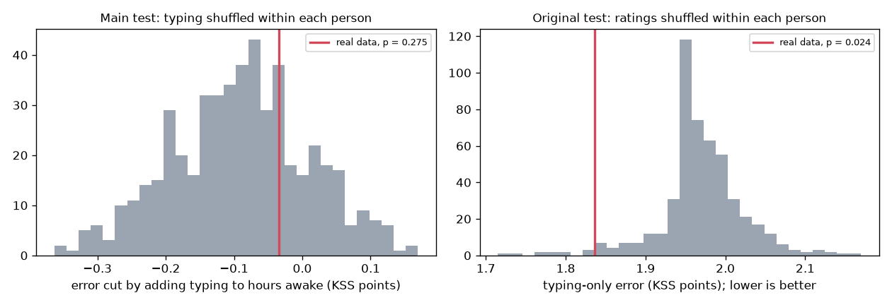
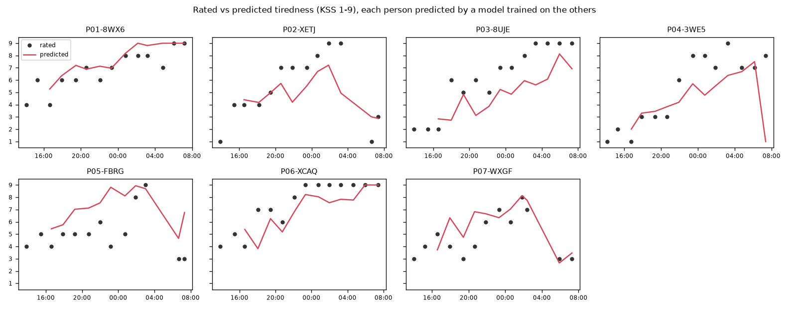
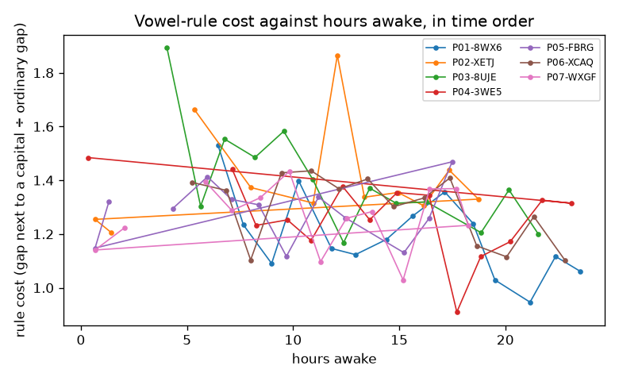
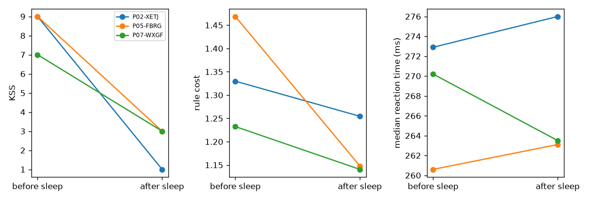
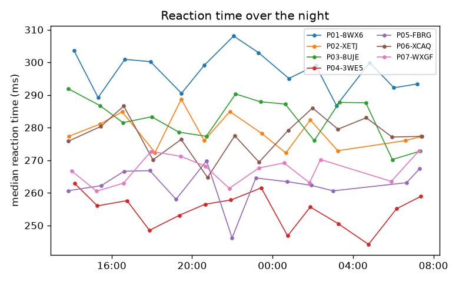

# Tiredness from typing: results

Data from `../data/sim/null`, analysed Sat 07 Nov 17:32. 122 check-ins: 95 from 7 panel people and 27 from 20 one-off people. 81 panel check-ins are scored; each person's first 2 are their baseline.

- 4 vowel task timings dropped because the page lost focus.
- 10 free text timings dropped because the page lost focus.
- 4 check-ins were stopped early; their finished tasks are used.

## Findings

- Typing did not clearly add to hours awake: the average error went from 1.40 to 1.44 KSS points (shuffle test p = 0.275). That's a null result.
- The original test, which shuffles ratings within each person, gives p = 0.024. It would call typing predictive, but only because typing and tiredness both drift over the night; the main test shows typing adds nothing beyond the clock.
- After allowing for practice, the rule cost changed by -0.002 per hour awake (95% CI -0.008 to 0.004), which isn't clearly different from zero.
- Gaps next to a capital took 1.32× as long as ordinary gaps (Wilcoxon p < 0.001, 118 check-ins), so the vowel rule does cost time.
- Across 3 sleeps, KSS changed by -6.0 on average and the rule cost by -0.16.
- For 20 one-off people, who have no baseline, the model was no better than always guessing the panel average (error 1.55 vs 1.53 KSS points).

## Does typing add anything to hours awake?

Each person is predicted by a model trained on everyone else. Anchored models predict the change from the person's own baseline rating, then add it back.

| Model | Error (MAE, KSS points) | Spearman | Spearman within person (median) |
|---|---|---|---|
| Training mean | 1.93 | – | – |
| Own baseline rating | 3.15 | – | – |
| Hours awake | 1.40 | 0.60 | 0.88 |
| Typing only | 2.17 | 0.07 | 0.11 |
| Hours awake + typing (main) | 1.44 | 0.60 | 0.80 |
| Hours awake + typing + reaction test | 1.43 | 0.62 | 0.80 |
| Hours awake + typing, no rule cost | 1.31 | 0.64 | 0.83 |
| Hours awake + typing, not anchored | 1.26 | 0.70 | 0.86 |

**Main test.** Adding typing to hours awake changes the error from 1.40 to 1.44 KSS points. Shuffling the typing features within each person 500 times gives p = 0.275.

**Original test.** Shuffling ratings within each person, as in the plan, gives a typing-only error of 1.84 and p = 0.024. This test can't tell typing apart from anything else that drifts over the night.

**Tired vs alert** (above each person's median KSS or not): AUC 0.67 with hours awake and typing, 0.79 with hours awake alone.

## Mixed models

### Tiredness

`kss ~ hours_awake + log_checkin + vt_gap_cv_z + vt_rule_cost_z`, random intercept per person.

91 check-ins from 7 people.

| Term | Coefficient | 95% CI | p |
|---|---|---|---|
| Intercept | 1.183 | 0.284 to 2.082 | 0.010 |
| hours_awake | 0.249 | 0.195 to 0.303 | < 0.001 |
| log_checkin | 1.104 | 0.668 to 1.540 | < 0.001 |
| vt_gap_cv_z | 0.092 | -0.081 to 0.265 | 0.299 |
| vt_rule_cost_z | 0.478 | 0.092 to 0.864 | 0.015 |

### Rule cost

`vt_rule_cost ~ hours_awake + log_checkin`, random intercept per person.

91 check-ins from 7 people.

| Term | Coefficient | 95% CI | p |
|---|---|---|---|
| Intercept | 1.470 | 1.378 to 1.561 | < 0.001 |
| hours_awake | -0.002 | -0.008 to 0.004 | 0.502 |
| log_checkin | -0.081 | -0.127 to -0.034 | < 0.001 |

## Is the vowel rule really harder?

Median gap next to a capital ÷ median ordinary gap: 1.32 across 118 check-ins (Wilcoxon signed-rank p < 0.001).

## Before and after sleep

| Person | Slept (min) | KSS | Rule cost | Median RT (ms) |
|---|---|---|---|---|
| P02-XETJ | 162 | 9 → 1 | 1.33 → 1.25 | 273 → 276 |
| P05-FBRG | 179 | 9 → 3 | 1.47 → 1.15 | 261 → 263 |
| P07-WXGF | 171 | 7 → 3 | 1.23 → 1.14 | 270 → 264 |

## One-off people

A model trained on all panel check-ins, using only features that need no baseline (vt_rule_cost, vt_gap_cv, vt_accuracy, backspace_per100), predicted 27 check-ins from 20 one-off people with an error of 1.55 KSS points. Always guessing the panel average gives 1.53.

## Notes

- Typing features in the models: vt_rule_cost_z, vt_shift_lead_med_z, vt_wpm_z, vt_gap_cv_z, vt_hold_med_z, vt_pause1s_share_z, vt_accuracy_z, backspace_per100_z, ft_word_gap_med_z, ft_pause2s_share_z.
- Fixed features with no data here: wpm_ratio_z, gap_ratio_z, cv_ratio_z, acc_diff_z.
- Reaction-test features: rt_speed_z, rt_lapse_rate_z.
- `_z` features are each person's change from their first two check-ins, divided by the baseline spread pooled across the panel. Hours awake reset after a sleep of an hour or more.
- Lapses are reaction times of 355 ms or more, the cut-off for the 3-minute test.
